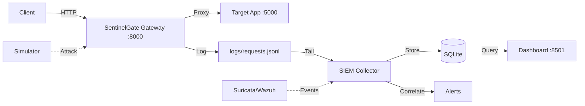

# SentinelGate 🛡️

**Open-source self-defending security gateway** combining IDPS, SIEM, ML anomaly detection, and automated response in a single reverse proxy.

[](LICENSE)
[](https://www.python.org/downloads/)

---

## 🚀 Features

- **🔍 IDPS (Intrusion Detection/Prevention)**: 30+ signature rules detecting SQLi, XSS, path traversal, command injection, SSRF, and scanner activity
- **📊 SIEM**: Event collection, normalization, storage (SQLite), correlation engine with multi-stage attack detection
- **🤖 ML Anomaly Detection**: IsolationForest scoring per-IP behavior over 60-second windows (optional, degrades gracefully)
- **⚖️ CVSS v3.1 Scoring**: Automatic severity scoring for attacks and security findings
- **🛡️ Rate Limiting**: Per-IP token bucket with allowlist, temporary bans, and escalation ladder
- **🔗 Tamper-Evident Audit Log**: SHA-256 hash-chained action log for forensic integrity
- **🔐 Security Scanners**: Headers, TLS, ports (nmap), dependencies (pip-audit), code quality (bandit)
- **📈 Risk Engine**: Weighted scoring (ML 30%, rules 30%, reputation 20%, CVSS 20%) with configurable thresholds
- **🎯 Automated Response**: Throttle/ban/block actions with audit trail; Telegram alerts for high/critical events
- **📱 Streamlit Dashboard**: Live KPIs, alerts, event log, top attackers, blocklist management
- **🧪 Attack Simulator**: Lab-safe traffic generator (brute force, SQLi, XSS, scanning, DoS-lite, mixed)
- **🔌 Optional Integrations**: Suricata (network IDS), Wazuh (SIEM/XDR)

---

## 📐 Architecture



**Request Flow:**
1. Client → Gateway (allowlist/ban check → rate limit → IDPS rules)
2. Critical/high severity → 403 blocked + logged
3. Medium/low → tag and proxy upstream
4. Background: ML scorer, correlation engine, risk calculator, response actions
5. Dashboard queries SQLite for real-time visibility

**Event Schema:** `timestamp`, `source_ip`, `method`, `path`, `query`, `status`, `user_agent`, `latency_ms`, `rule_hit`, `attack_type`, `ml_score`, `cvss_score`, `risk_score` (0-100), `action` (allow/throttle/block), `source` (gateway/suricata/wazuh)

**Risk Formula:**  
`risk = 100 × (0.3×ml_score + 0.3×rule_score + 0.2×reputation + 0.2×cvss/10)`

**Thresholds:** ≥40 alert, ≥60 throttle (15 min), ≥80 block (24 hr), escalation to permanent

---

## ⚡ Quick Start

**Requirements:** Python 3.12+, 8 GB RAM, Windows/Linux/macOS

```powershell
# 1. Clone and enter directory
git clone https://github.com/yourusername/sentinelgate.git
cd sentinelgate

# 2. Create virtual environment
python -m venv .venv
.\.venv\Scripts\Activate.ps1    # Windows PowerShell
# source .venv/bin/activate     # Linux/macOS

# 3. Install dependencies
pip install -r requirements.txt

# 4. Configure
copy .env.example .env
# Edit .env: set TARGET_URL, RATE_LIMIT, etc.

# 5. Run the demo
.\demo.ps1   # Starts test app, gateway, collector, simulator, dashboard
```

Set `DASHBOARD_PASSWORD` in `.env` before starting the dashboard; login fails closed
if it is unset. The dashboard opens at **http://localhost:8501**.

---

## 📦 Configuration

Create `.env` from `.env.example` and customize:

| Variable | Default | Description |
|----------|---------|-------------|
| `TARGET_URL` | `http://127.0.0.1:5000` | Upstream application to protect |
| `RATE_LIMIT` | `60` | Requests per minute per IP |
| `RATE_BURST` | `20` | Burst allowance |
| `TRUST_PROXY` | `false` | Trust X-Forwarded-For header |
| `DB_PATH` | `logs/siem.db` | SQLite database path |
| `ALLOWED_TARGETS` | `""` | Comma-separated IPs for scanner/simulator |
| `ALLOWLIST` | `""` | IPs exempt from rate limiting and bans |
| `DASHBOARD_PASSWORD` | (required) | Dashboard login password |
| `TELEGRAM_TOKEN` | `""` | Telegram bot token (optional) |
| `TELEGRAM_CHAT_ID` | `""` | Telegram chat ID (optional) |
| `NVD_API_KEY` | `""` | NVD API key (optional, for CVE lookups) |
| `ABUSEIPDB_KEY` | `""` | AbuseIPDB API key (optional, for reputation) |
| `ENABLE_SURICATA` | `false` | Tail Suricata eve.json |
| `ENABLE_WAZUH` | `false` | Poll Wazuh API for alerts |

---

## 🖥️ Landing Page

The static site lives in `web/` and is fully self-contained (no build step,
no analytics, no network calls except the optional Google Fonts stylesheet).

```powershell
# Serve the repository root so the page's relative docs links work
python -m http.server 8080
# Open http://localhost:8080/web/
```

With Docker Compose, the `web` service serves the same page at
**http://localhost:8080/** (redirects to `/web/`). The page respects
`prefers-reduced-motion`, has a skip link, and is keyboard navigable.

## 🧪 Testing

```powershell
# Run all tests
python -m pytest

# With coverage
python -m pytest --cov=. --cov-report=html

# Specific module
python -m pytest tests/test_idps.py -v

# Linting
python -m ruff check .
```

**Current Coverage:** 88% overall; the required packages are all above 80%
(gateway 87%, idps 83%, siem 84%, response 97%, audit 93%).

---

## 🎯 Attack Simulator

Generate test traffic (localhost only by default):

```powershell
# Brute force login attempts
python -m simulator.run brute_force --count 30

# SQL injection
python -m simulator.run sqli --count 20

# Mixed scenario (all attack types)
python -m simulator.run mixed --target http://127.0.0.1:8000 --count 50
```

**Scenarios:** `brute_force`, `sqli`, `xss`, `path_traversal`, `scan`, `dos_lite`, `mixed`

---

## 📚 Project Structure

```
sentinelgate/
├── gateway/          # FastAPI reverse proxy + IDPS
├── idps/             # Signature rules (YAML) and engine
├── siem/             # Storage, parsers, correlation, collector
├── ml/               # Feature extraction, training, live detector
├── audit/            # CVSS engine, hashchain, scanners
├── response/         # Risk engine, actions, Telegram alerts
├── cases/            # SOC case management
├── mitre/            # MITRE ATT&CK mappings
├── intel/            # IP reputation enrichment
├── playbooks/        # Automated response playbooks
├── reports/          # PDF incident/audit reports
├── dashboard/        # Streamlit UI
├── simulator/        # Attack traffic generator
├── testapp/          # Deliberately vulnerable Flask app
├── web/              # Static landing page (open web/index.html)
├── tests/            # Pytest suite
├── docs/             # Additional documentation
├── logs/             # Runtime logs and database
├── models/           # Trained ML models
└── demo.ps1          # All-in-one demo script
```

---

## 🔧 Advanced Usage

### Train Custom ML Model

```powershell
# From real traffic logs
python -m ml.train --input logs/requests.jsonl --output models/custom.joblib

# From synthetic baseline
python -m ml.train --synthetic --output models/baseline.joblib

# Evaluate
python -m ml.evaluate --output docs/ml-evaluation.md
```

### Run Components Separately

```powershell
# Test app (port 5000)
python -m testapp.app

# Gateway (port 8000)
python -m uvicorn gateway.main:app --host 127.0.0.1 --port 8000

# Collector (tail mode)
python -m siem.collector --follow

# Dashboard (port 8501)
streamlit run dashboard/app.py
```

### Security Scans

```powershell
# Headers + TLS
python -c "from audit.scanners.headers import scan_headers; print(scan_headers('http://localhost:8000'))"

# Port scan (requires nmap)
python -c "from audit.scanners.ports import scan_ports; print(scan_ports('http://localhost'))"

# Code quality (requires bandit)
python -m bandit -r . -f json

# Dependency vulnerabilities (requires pip-audit)
pip-audit --format json
```

---

## 🛠️ Development

```powershell
# Setup development environment
python -m venv .venv
.\.venv\Scripts\Activate.ps1
pip install -r requirements.txt

# Run linter
python -m ruff check . --fix

# Run security checks
python -m bandit -r . -q
pip-audit

# Format code
python -m ruff format .
```

---

## ⚠️ Responsible Use

**This tool is for authorized testing only.**

- Only run the gateway, scanners, and simulator against systems **you own** or have **written permission** to test.
- The test app (`testapp/app.py`) is **deliberately vulnerable** for lab use. Never expose it to a network.
- Attacks and scans are **restricted to localhost/127.0.0.1** by default. Use `ALLOWED_TARGETS` only for systems you control.

Unauthorized testing is illegal. Use responsibly.

---

## 📖 Documentation

- **[Deployment](docs/deployment.md)** — Local, Docker, and production deployment
- **[Integrations](docs/integrations.md)** — Suricata, Wazuh setup
- **[Security Review](docs/security-review.md)** — Phase 16 review and results
- **[Deployment Checklist](docs/deployment-checklist.md)** — Pre-flight checks
- **[ML Evaluation](docs/ml-evaluation.md)** — Model performance metrics (generated by `ml.evaluate`)

---

## 🗺️ Roadmap

- [x] **Phase 0-7**: Foundation, gateway, IDPS, SIEM, ML, CVSS, audit, risk engine, response
- [x] **Phase 8**: SOC features (cases, MITRE mapping, playbooks, threat intel)
- [x] **Phase 9-10**: Dashboard, simulator
- [x] **Phase 11**: Suricata and Wazuh integrations
- [x] **Phase 12**: PDF reports (incident, audit)
- [x] **Phase 13**: Landing page (HTML/CSS/JS with particle animation)
- [x] **Phase 14**: Docker Compose, CI, task scripts
- [x] **Phase 15**: Documentation, contributing and security policies
- [x] **Phase 16**: Security review (bandit, pip-audit, auth hardening)

**Future:**
- Sigma rule import
- Redis distributed backend
- Multi-tenancy
- REST API for programmatic access
- Webhook notifications (Slack, PagerDuty)

---

## 🤝 Contributing

Contributions welcome! See [CONTRIBUTING.md](CONTRIBUTING.md) for guidelines.

1. Fork the repo
2. Create a feature branch (`git checkout -b feature/amazing`)
3. Commit your changes (`git commit -m 'Add amazing feature'`)
4. Push to the branch (`git push origin feature/amazing`)
5. Open a Pull Request

**Good First Issues:** Check the issue tracker for beginner-friendly tasks.

---

## 📄 License

MIT License — see [LICENSE](LICENSE) for details.

---

## 🙏 Credits

- **Suricata** — Open-source network IDS/IPS
- **Wazuh** — Open-source SIEM and XDR platform
- **scikit-learn** — Machine learning library
- **FastAPI**, **Streamlit**, **Flask** — Python web frameworks
- **MITRE ATT&CK** — Threat intelligence framework
- **CVSS** — Common Vulnerability Scoring System
- **CSIC 2010 HTTP Dataset** — Web attack dataset (optional for ML training)

---

## 📬 Contact

- **Issues:** [GitHub Issues](https://github.com/yourusername/sentinelgate/issues)
- **Security:** See [SECURITY.md](SECURITY.md) for reporting vulnerabilities

---

**Built with ❤️ for security learners, small teams, and SOC training labs.**

*Make it true.*
# SentinelGate

